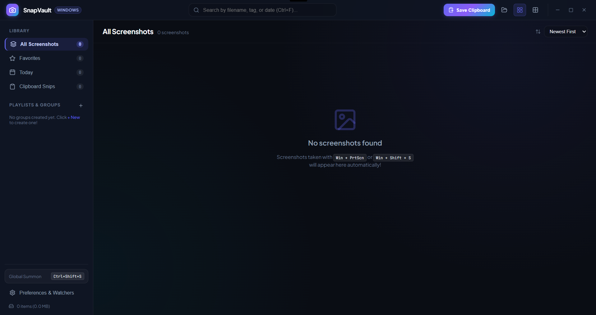

# SnapVault 📸

**A Windows screenshot manager that collects, organizes and searches your screenshots and clipboard snips in one place.**

SnapVault runs quietly in the system tray, watches your screenshot folders and the clipboard, and builds a searchable library with tags, notes, favorites and custom groups. A global hotkey brings it up from any app.



> **Platform:** Windows 10 / 11 only.

---

## Features

**Automatic capture**
- Watches the Windows screenshot folder (`Pictures\Screenshots`) for captures made with `PrtScn` or `Win + PrtScn`.
- Watches any extra folders you add in Settings.
- Detects images copied to the clipboard by `Win + Shift + S` or the Snipping Tool, and saves them to `Pictures\SnapVault` so unsaved snips are not lost.

**Organize and find**
- Timeline grouped into **Today**, **Yesterday**, **This Week** and **Earlier**.
- **Favorites**, a **Clipboard** view for captured snips, and your own **groups** with custom names and colors.
- **Tags** (for example `#bug`, `#design`, `#receipt`) and free-text **notes** on every screenshot.
- Instant search with `Ctrl + F` across filenames, tags and notes.
- Standard and compact grid views.

**Use your screenshots**
- Lightbox viewer with zoom, pan, arrow-key navigation and a details panel.
- One-click copy of an image back to the clipboard.
- Drag a screenshot straight out of SnapVault into Discord, Slack, Photoshop or a browser.
- Show in Explorer, or open in the default Windows viewer.
- Delete sends the file to the Windows Recycle Bin.

**Desktop integration**
- Global hotkey (`Ctrl + Shift + S` by default) to show or hide the window from anywhere.
- System tray menu: open SnapVault, capture from clipboard, open the screenshots folder, quit.
- Optional Windows notifications, and an option to minimize to the tray when the window is closed.
- Dark, frameless window with a glass-style interface.

## Keyboard shortcuts

| Shortcut | Action |
| :--- | :--- |
| `Ctrl + Shift + S` | Show or hide SnapVault from any app (default global hotkey) |
| `Win + Shift + S` | Windows snip, picked up automatically by SnapVault |
| `Win + PrtScn` | Full-screen Windows capture, picked up automatically |
| `Ctrl + F` | Focus the search bar |
| `Left` / `Right` | Previous / next screenshot in the lightbox |
| `Esc` | Close the lightbox or settings |

Note that `Ctrl + Shift + S` is registered system-wide, so another app that uses the same shortcut may conflict with it.

## Tech stack

- [Electron](https://www.electronjs.org/) for the desktop shell, tray, global hotkey, clipboard and native drag and drop
- [React](https://react.dev/) 19 and [Vite](https://vitejs.dev/) for the interface
- [chokidar](https://github.com/paulmillr/chokidar) for folder watching
- [lucide-react](https://lucide.dev/) for icons
- [electron-builder](https://www.electron.build/) to produce the NSIS installer and the portable build

## Getting started

**Requirements:** Windows 10 or 11 and Node.js 18 or newer (developed on Node 22).

```bash
git clone https://github.com/malsaaaa/snap-vault.git
cd snap-vault
npm install
```

| Command | What it does |
| :--- | :--- |
| `npm run dev` | Start the Vite dev server and Electron together |
| `npm run build` | Build the React front end into `dist/` |
| `npm start` | Launch the built app with Electron |
| `npm run dist` | Build and package both the installer and the portable `.exe` |
| `npm run dist:installer` | Package the Setup installer only |
| `npm run dist:portable` | Package the portable `.exe` only |

Packaged files are written to `release/`.

## Project structure

```
snap-vault/
├── src/
│   ├── main/                  # Electron main process
│   │   ├── main.js            # Window, tray, hotkey, IPC handlers
│   │   ├── watcher.js         # Screenshot folder watching
│   │   ├── clipboard-watcher.js  # Clipboard snip capture
│   │   └── store.js           # Settings, tags, notes, favorites and groups
│   ├── preload/preload.js     # Safe bridge exposed to the UI
│   └── renderer/              # React interface (Vite)
│       └── src/components/    # Sidebar, grid, lightbox, settings, groups
├── assets/                    # App icon
├── scripts/                   # Icon generation helpers
└── vite.config.mjs
```

## Data and privacy

- Your screenshots stay where they are as ordinary image files. SnapVault does not upload, sync or send anything over a network.
- Tags, notes, favorites, groups and settings are stored locally in `snapvault-data.json` in the app's user-data folder.
- Snips captured from the clipboard are saved to `Pictures\SnapVault`.

## Status

Version 1.0.0, an early release. The app is built and tested on Windows only.

## License

[MIT](LICENSE)
